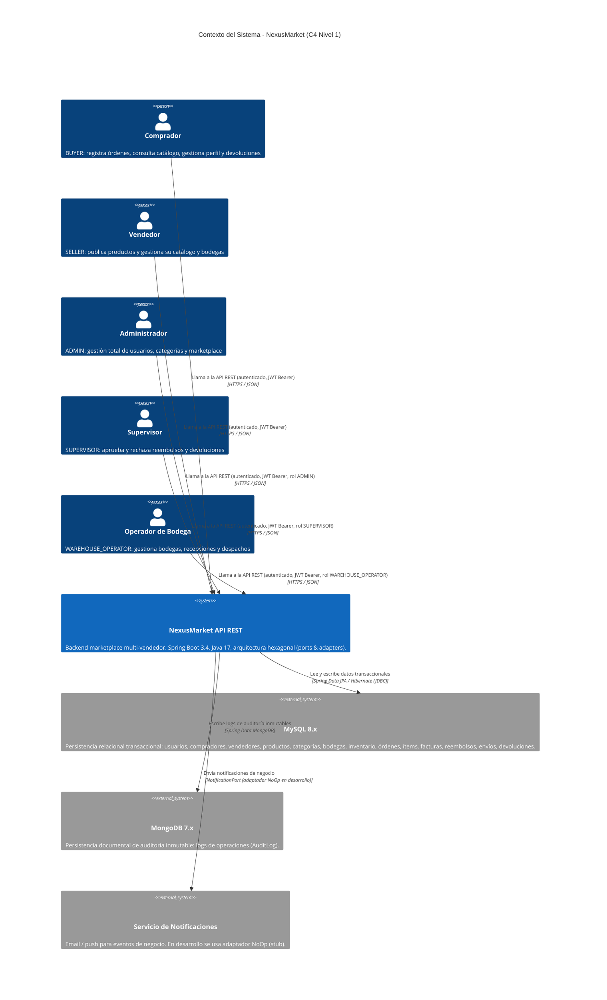

# C4 — Nivel 1: Contexto

Diagrama de contexto del sistema NexusMarket con los 5 actores de negocio y los sistemas externos.

## Actores (5 roles)

| Actor | Rol en el código | Endpoints principales |
|-------|------------------|-----------------------|
| Comprador | `BUYER` | `/api/orders`, `/api/returns`, `/api/users/me`, `/api/buyers` |
| Vendedor | `SELLER` | `/api/products`, `/api/sellers` |
| Administrador | `ADMIN` | `/api/users/**`, `/api/audit/**`, administración completa |
| Supervisor | `SUPERVISOR` | `/api/audit/**`, aprobación de reembolsos/devoluciones |
| Operador de Bodega | `WAREHOUSE_OPERATOR` | `/api/warehouses`, `/api/inventories`, `/api/shipments`, despacho de órdenes |

## Sistemas externos

| Sistema | Tecnología | Responsabilidad |
|---------|------------|-----------------|
| MySQL | MySQL 8.x + Spring Data JPA | Datos transaccionales del marketplace |
| MongoDB | MongoDB 7.x + Spring Data Mongo | Auditoría inmutable de operaciones |
| Servicio de Notificaciones | `NotificationPort` / `NoOpNotificationAdapter` | Notificaciones email/push (stub en desarrollo) |
