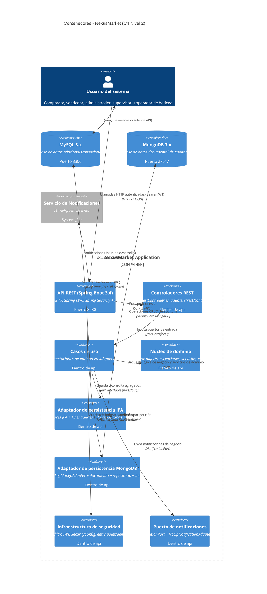

# C4 — Nivel 2: Contenedores

Diagrama de contenedores: la API REST, los adaptadores de persistencia, la base de datos relacional (MySQL), MongoDB y el sistema externo de notificaciones.

## Resumen de contenedores

| Contenedor | Tecnología | Detalle |
|------------|------------|---------|
| API REST | Spring Boot 3.4 / Java 17 | 15 controladores, Puerto 8080 |
| Adaptador JPA | Spring Data JPA + Hibernate | MySQL, 13 entidades, 13 repositorios |
| Adaptador MongoDB | Spring Data MongoDB | Auditoría (AuditLog) |
| Seguridad | Spring Security + JWT | Stateless, HMAC-SHA256, RBAC 5 roles |
| Notificaciones | `NotificationPort` (NoOp) | Stub sin implementar |
| BD relacional | MySQL 8.x | Puerto 3306, BD `nexusmarket` |
| BD documental | MongoDB 7.x | Puerto 27017, BD `nexusmarket_audit` |
