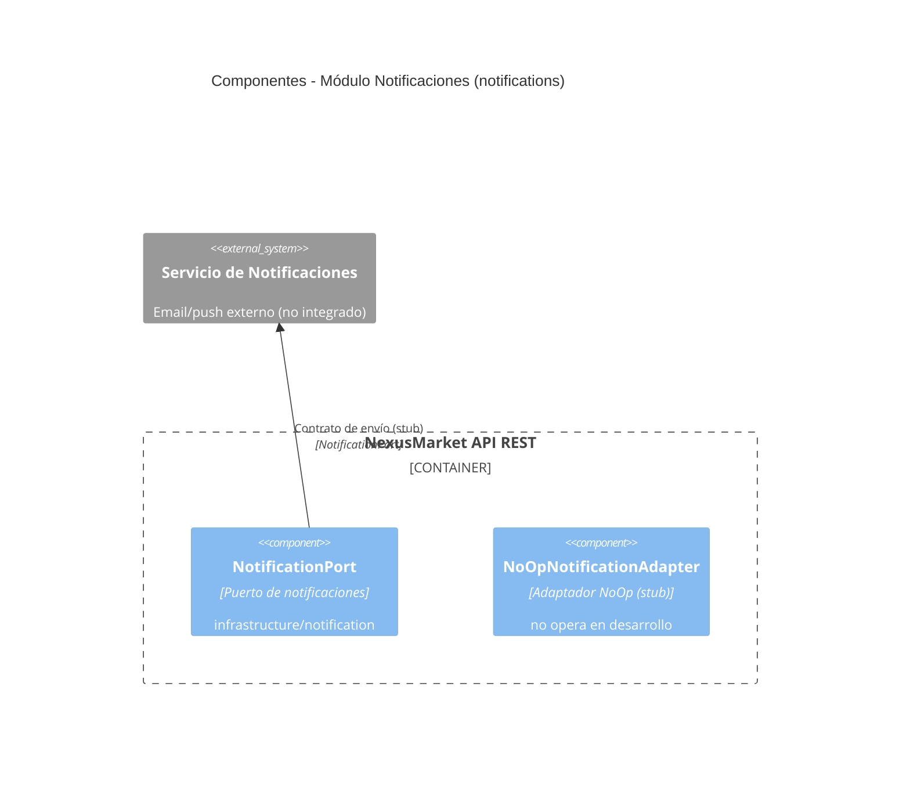

# C4 — Nivel 3: Componentes

Un diagrama de componentes por módulo de negocio. Cada uno muestra el controlador REST, el caso de uso, los servicios de dominio, los puertos de entrada/salida, el adaptador de persistencia, el repositorio y la base de datos.

---

## Módulo: Autenticación

```mermaid
C4Component
    title Componentes - Módulo Autenticación (auth)

    Container_Boundary(api, "NexusMarket API REST") {
        Component(ctrl, "AuthController", "REST Controller", "Spring MVC @RestController")
        Component(uc, "AuthenticationUseCaseImpl", "Caso de uso: autenticación", "implements AuthenticationUseCasePort")
        PortIn(pi, "AuthenticationUseCasePort", "Puerto de entrada")
        Component(svc, "UserManagementService", "Servicio de dominio", "valida credenciales BCrypt")
        Component(jwt, "JwtService", "Genera/valida JWT", "infrastructure/security")
        PortOut(po, "UserRepositoryPort", "Puerto de salida")
        Component(adapter, "UserJpaAdapter", "Adaptador JPA (User)", "implements UserRepositoryPort")
        Component(repo, "UserJpaRepository", "Repositorio", "JpaRepository")
        ContainerDb(mysql, "MySQL 8.x", "Tabla usuarios", "JDBC")
    }

    Rel(ctrl, uc, "Invoca", "register / login")
    Rel(uc, pi, "Implementa", "Java interface")
    Rel(uc, svc, "Delega validación", "Java")
    Rel(svc, jwt, "Genera token", "JJWT")
    Rel(uc, po, "Consulta usuario", "Java interface")
    Rel(adapter, po, "Implementa", "Java interface")
    Rel(adapter, repo, "Llama", "Spring Data")
    Rel(repo, mysql, "SQL", "JDBC")
```

---

## Módulo: Usuarios, Compradores y Vendedores

```mermaid
C4Component
    title Componentes - Módulo Usuarios (users, buyers, sellers)

    Container_Boundary(api, "NexusMarket API REST") {
        Component(ucCtrl, "UserController", "REST Controller", "/api/v1/admin/users")
        Component(bCtrl, "BuyerController", "REST Controller", "/api/v1/buyer/buyers")
        Component(bAdminCtrl, "BuyerManagementController", "REST Controller", "/api/v1/admin/buyers")
        Component(sCtrl, "SellerController", "REST Controller", "/api/v1/seller/sellers")

        Component(uUc, "UserUseCaseImpl", "Caso de uso: usuarios", "implements UserUseCasePort")
        Component(bUc, "BuyerUseCaseImpl", "Caso de uso: compradores", "implements BuyerUseCasePort")
        Component(sUc, "SellerUseCaseImpl", "Caso de uso: vendedores", "implements SellerUseCasePort")

        PortIn(uPi, "UserUseCasePort", "Puerto de entrada")
        PortIn(bPi, "BuyerUseCasePort", "Puerto de entrada")
        PortIn(sPi, "SellerUseCasePort", "Puerto de entrada")

        Component(uSvc, "UserManagementService", "Servicio de dominio", "usuarios")
        Component(bCreate, "CreateBuyerService", "Servicio de dominio", "alta de comprador")
        Component(bAddress, "AddBuyerAddressService", "Servicio de dominio", "direcciones")
        Component(bStatus, "ChangeBuyerCommercialStatusService", "Servicio de dominio", "estado comercial")
        Component(sSvc, "SellerDomainService", "Servicio de dominio", "vendedores")

        PortOut(uPo, "UserRepositoryPort", "Puerto de salida")
        PortOut(bPo, "BuyerRepositoryPort", "Puerto de salida")
        PortOut(sPo, "SellerRepositoryPort", "Puerto de salida")

        Component(uAdapter, "UserJpaAdapter", "Adaptador JPA (User)", "")
        Component(bAdapter, "BuyerJpaAdapter", "Adaptador JPA (Buyer)", "")
        Component(sAdapter, "SellerJpaAdapter", "Adaptador JPA (Seller)", "")

        Component(uRepo, "UserJpaRepository", "Repositorio", "")
        Component(bRepo, "BuyerJpaRepository", "Repositorio", "")
        Component(sRepo, "SellerJpaRepository", "Repositorio", "")

        ContainerDb(mysql, "MySQL 8.x", "Tablas users, buyers, sellers", "JDBC")
    }

    Rel(ucCtrl, uUc, "Invoca", "Java")
    Rel(bCtrl, bUc, "Invoca", "Java")
    Rel(bAdminCtrl, bUc, "Invoca (ADMIN)", "Java")
    Rel(sCtrl, sUc, "Invoca", "Java")
    Rel(uUc, uPi, "Implementa", "")
    Rel(bUc, bPi, "Implementa", "")
    Rel(sUc, sPi, "Implementa", "")
    Rel(uUc, uSvc, "Delega", "")
    Rel(bUc, bCreate, "Delega", "")
    Rel(bUc, bAddress, "Delega", "")
    Rel(bUc, bStatus, "Delega", "")
    Rel(sUc, sSvc, "Delega", "")
    Rel(uUc, uPo, "Persiste/consulta", "")
    Rel(bUc, bPo, "Persiste/consulta", "")
    Rel(sUc, sPo, "Persiste/consulta", "")
    Rel(uAdapter, uPo, "Implementa", "")
    Rel(bAdapter, bPo, "Implementa", "")
    Rel(sAdapter, sPo, "Implementa", "")
    Rel(uAdapter, uRepo, "Llama", "")
    Rel(bAdapter, bRepo, "Llama", "")
    Rel(sAdapter, sRepo, "Llama", "")
    Rel(uRepo, mysql, "SQL", "")
    Rel(bRepo, mysql, "SQL", "")
    Rel(sRepo, mysql, "SQL", "")
```

---

## Módulo: Catálogo (productos, categorías, bodegas, catálogo general)

```mermaid
C4Component
    title Componentes - Módulo Catálogo (catalog)

    Container_Boundary(api, "NexusMarket API REST") {
        Component(pCtrl, "ProductController", "REST Controller", "/api/v1/seller/products")
        Component(cCtrl, "CategoryController", "REST Controller", "/api/v1/admin/categories")
        Component(wCtrl, "WarehouseController", "REST Controller", "/api/v1/warehouse/warehouses")
        Component(catCtrl, "CatalogController", "REST Controller", "/api/v1/catalog")

        Component(pUc, "ProductUseCaseImpl", "Caso de uso: productos", "implements ProductUseCasePort")
        Component(cUc, "CategoryUseCaseImpl", "Caso de uso: categorías", "implements CategoryUseCasePort")
        Component(wUc, "WarehouseUseCaseImpl", "Caso de uso: bodegas", "implements WarehouseUseCasePort")
        Component(catUc, "CatalogUseCaseImpl", "Caso de uso: catálogo general", "implements CatalogUseCasePort")

        PortIn(pPi, "ProductUseCasePort", "Puerto de entrada")
        PortIn(cPi, "CategoryUseCasePort", "Puerto de entrada")
        PortIn(wPi, "WarehouseUseCasePort", "Puerto de entrada")
        PortIn(catPi, "CatalogUseCasePort", "Puerto de entrada")

        Component(pSvc, "ProductDomainService", "Servicio de dominio", "reglas de producto")
        Component(cSvc, "CategoryDomainService", "Servicio de dominio", "reglas de categoría")
        Component(wSvc, "WarehouseDomainService", "Servicio de dominio", "reglas de bodega")

        PortOut(pPo, "ProductRepositoryPort", "Puerto de salida")
        PortOut(cPo, "CategoryRepositoryPort", "Puerto de salida")
        PortOut(wPo, "WarehouseRepositoryPort", "Puerto de salida")

        Component(pAdapter, "ProductJpaAdapter", "Adaptador JPA (Product)", "")
        Component(cAdapter, "CategoryJpaAdapter", "Adaptador JPA (Category)", "")
        Component(wAdapter, "WarehouseJpaAdapter", "Adaptador JPA (Warehouse)", "")

        Component(pRepo, "ProductJpaRepository", "Repositorio", "")
        Component(cRepo, "CategoryJpaRepository", "Repositorio", "")
        Component(wRepo, "WarehouseJpaRepository", "Repositorio", "")

        ContainerDb(mysql, "MySQL 8.x", "Tablas products, categories, warehouses", "JDBC")
    }

    Rel(pCtrl, pUc, "Invoca", "Java")
    Rel(cCtrl, cUc, "Invoca", "Java")
    Rel(wCtrl, wUc, "Invoca", "Java")
    Rel(catCtrl, catUc, "Invoca", "Java")
    Rel(pUc, pPi, "Implementa", "")
    Rel(cUc, cPi, "Implementa", "")
    Rel(wUc, wPi, "Implementa", "")
    Rel(catUc, catPi, "Implementa", "")
    Rel(pUc, pSvc, "Delega", "")
    Rel(cUc, cSvc, "Delega", "")
    Rel(wUc, wSvc, "Delega", "")
    Rel(pUc, pPo, "Persiste/consulta", "")
    Rel(cUc, cPo, "Persiste/consulta", "")
    Rel(wUc, wPo, "Persiste/consulta", "")
    Rel(pAdapter, pPo, "Implementa", "")
    Rel(cAdapter, cPo, "Implementa", "")
    Rel(wAdapter, wPo, "Implementa", "")
    Rel(pAdapter, pRepo, "Llama", "")
    Rel(cAdapter, cRepo, "Llama", "")
    Rel(wAdapter, wRepo, "Llama", "")
    Rel(pRepo, mysql, "SQL", "")
    Rel(cRepo, mysql, "SQL", "")
    Rel(wRepo, mysql, "SQL", "")
```

---

## Módulo: Inventario

```mermaid
C4Component
    title Componentes - Módulo Inventario (inventory)

    Container_Boundary(api, "NexusMarket API REST") {
        Component(ctrl, "InventoryController", "REST Controller", "/api/v1/warehouse/inventories")
        Component(uc, "InventoryUseCaseImpl", "Caso de uso: inventario", "implements InventoryUseCasePort")
        PortIn(pi, "InventoryUseCasePort", "Puerto de entrada")

        Component(mSvc, "InventoryManagementService", "Servicio de dominio", "reserva/ajuste/dañado")
        Component(cSvc, "InventoryConsultService", "Servicio de dominio", "consultas de inventario")

        PortOut(po, "InventoryRepositoryPort", "Puerto de salida")
        Component(adapter, "InventoryJpaAdapter", "Adaptador JPA (Inventory)", "")
        Component(repo, "InventoryJpaRepository", "Repositorio", "")

        ContainerDb(mysql, "MySQL 8.x", "Tabla inventories", "JDBC")
    }

    Rel(ctrl, uc, "Invoca", "Java")
    Rel(uc, pi, "Implementa", "")
    Rel(uc, mSvc, "Delega", "")
    Rel(uc, cSvc, "Delega", "")
    Rel(uc, po, "Persiste/consulta", "")
    Rel(adapter, po, "Implementa", "")
    Rel(adapter, repo, "Llama", "")
    Rel(repo, mysql, "SQL", "")
```

---

## Módulo: Órdenes

```mermaid
C4Component
    title Componentes - Módulo Órdenes (orders)

    Container_Boundary(api, "NexusMarket API REST") {
        Component(ctrl, "OrderController", "REST Controller", "/api/v1/buyer/orders")
        Component(whCtrl, "WarehouseOrderController", "REST Controller", "/api/v1/warehouse/orders")
        Component(uc, "OrderUseCaseImpl", "Caso de uso: órdenes", "implements OrderUseCasePort")
        PortIn(pi, "OrderUseCasePort", "Puerto de entrada")

        Component(createSvc, "OrderCreateService", "Servicio de dominio", "crear orden")
        Component(calcSvc, "OrderCalculationService", "Servicio de dominio", "recalcular total")
        Component(lifeSvc, "OrderLifecycleService", "Servicio de dominio", "ciclo de vida de la orden")

        PortOut(po, "OrderRepositoryPort", "Puerto de salida")
        Component(adapter, "OrderJpaAdapter", "Adaptador JPA (Order, OrderItem)", "")
        Component(repo, "OrderJpaRepository", "Repositorio (Order)", "")
        Component(itemRepo, "OrderItemJpaRepository", "Repositorio (OrderItem)", "")

        ContainerDb(mysql, "MySQL 8.x", "Tablas orders, order_items", "JDBC")
    }

    Rel(ctrl, uc, "Invoca", "Java")
    Rel(whCtrl, uc, "Invoca (WAREHOUSE_OPERATOR)", "Java")
    Rel(uc, pi, "Implementa", "")
    Rel(uc, createSvc, "Delega", "")
    Rel(uc, calcSvc, "Delega", "")
    Rel(uc, lifeSvc, "Delega", "")
    Rel(uc, po, "Persiste/consulta", "")
    Rel(adapter, po, "Implementa", "")
    Rel(adapter, repo, "Llama (Order)", "")
    Rel(adapter, itemRepo, "Llama (OrderItem)", "")
    Rel(repo, mysql, "SQL", "")
    Rel(itemRepo, mysql, "SQL", "")
```

---

## Módulo: Facturación (facturas y reembolsos)

```mermaid
C4Component
    title Componentes - Módulo Facturación (invoices, refunds)

    Container_Boundary(api, "NexusMarket API REST") {
        Component(iCtrl, "InvoiceController", "REST Controller", "/api/v1/supervisor/invoices")
        Component(rCtrl, "RefundController", "REST Controller", "/api/v1/supervisor/refunds")

        Component(iUc, "InvoiceUseCaseImpl", "Caso de uso: facturas", "implements InvoiceUseCasePort")
        Component(rUc, "RefundUseCaseImpl", "Caso de uso: reembolsos", "implements RefundUseCasePort")

        PortIn(iPi, "InvoiceUseCasePort", "Puerto de entrada")
        PortIn(rPi, "RefundUseCasePort", "Puerto de entrada")

        Component(iGenSvc, "InvoiceGenerateService", "Servicio de dominio", "generar factura")
        Component(iVoidSvc, "InvoiceVoidService", "Servicio de dominio", "anular factura")
        Component(rProcSvc, "RefundProcessService", "Servicio de dominio", "procesar reembolso")
        Component(rApprSvc, "RefundApproveService", "Servicio de dominio", "aprobar/rechazar reembolso")

        PortOut(iPo, "InvoiceRepositoryPort", "Puerto de salida")
        PortOut(rPo, "RefundRepositoryPort", "Puerto de salida")

        Component(iAdapter, "InvoiceJpaAdapter", "Adaptador JPA (Invoice)", "")
        Component(rAdapter, "RefundJpaAdapter", "Adaptador JPA (Refund)", "")

        Component(iRepo, "InvoiceJpaRepository", "Repositorio", "")
        Component(rRepo, "RefundJpaRepository", "Repositorio", "")

        ContainerDb(mysql, "MySQL 8.x", "Tablas invoices, refunds", "JDBC")
    }

    Rel(iCtrl, iUc, "Invoca", "Java")
    Rel(rCtrl, rUc, "Invoca", "Java")
    Rel(iUc, iPi, "Implementa", "")
    Rel(rUc, rPi, "Implementa", "")
    Rel(iUc, iGenSvc, "Delega", "")
    Rel(iUc, iVoidSvc, "Delega", "")
    Rel(rUc, rProcSvc, "Delega", "")
    Rel(rUc, rApprSvc, "Delega", "")
    Rel(iUc, iPo, "Persiste/consulta", "")
    Rel(rUc, rPo, "Persiste/consulta", "")
    Rel(iAdapter, iPo, "Implementa", "")
    Rel(rAdapter, rPo, "Implementa", "")
    Rel(iAdapter, iRepo, "Llama", "")
    Rel(rAdapter, rRepo, "Llama", "")
    Rel(iRepo, mysql, "SQL", "")
    Rel(rRepo, mysql, "SQL", "")
```

---

## Módulo: Envíos (shipping)

```mermaid
C4Component
    title Componentes - Módulo Envíos (shipping / shipments)

    Container_Boundary(api, "NexusMarket API REST") {
        Component(ctrl, "ShipmentController", "REST Controller", "/api/v1/warehouse/shipments")
        Component(uc, "ShipmentUseCaseImpl", "Caso de uso: envíos", "implements ShipmentUseCasePort")
        PortIn(pi, "ShipmentUseCasePort", "Puerto de entrada")

        Component(createSvc, "ShipmentCreateService", "Servicio de dominio", "crear envío")
        Component(statusSvc, "ShipmentStatusService", "Servicio de dominio", "actualizar estado")

        PortOut(po, "ShipmentRepositoryPort", "Puerto de salida")
        Component(adapter, "ShipmentJpaAdapter", "Adaptador JPA (Shipment)", "")
        Component(repo, "ShipmentJpaRepository", "Repositorio", "")

        ContainerDb(mysql, "MySQL 8.x", "Tabla shipments", "JDBC")
    }

    Rel(ctrl, uc, "Invoca", "Java")
    Rel(uc, pi, "Implementa", "")
    Rel(uc, createSvc, "Delega", "")
    Rel(uc, statusSvc, "Delega", "")
    Rel(uc, po, "Persiste/consulta", "")
    Rel(adapter, po, "Implementa", "")
    Rel(adapter, repo, "Llama", "")
    Rel(repo, mysql, "SQL", "")
```

---

## Módulo: Devoluciones (returns)

```mermaid
C4Component
    title Componentes - Módulo Devoluciones (returns)

    Container_Boundary(api, "NexusMarket API REST") {
        Component(ctrl, "ReturnController", "REST Controller", "/api/v1/buyer/returns")
        Component(uc, "ReturnUseCaseImpl", "Caso de uso: devoluciones", "implements ReturnUseCasePort")
        PortIn(pi, "ReturnUseCasePort", "Puerto de entrada")

        Component(svc, "ReturnProcessService", "Servicio de dominio", "aprobar/rechazar/completar")

        PortOut(po, "ReturnRepositoryPort", "Puerto de salida")
        Component(adapter, "ReturnJpaAdapter", "Adaptador JPA (Return)", "")
        Component(repo, "ReturnJpaRepository", "Repositorio", "")

        ContainerDb(mysql, "MySQL 8.x", "Tabla returns", "JDBC")
    }

    Rel(ctrl, uc, "Invoca", "Java")
    Rel(uc, pi, "Implementa", "")
    Rel(uc, svc, "Delega", "")
    Rel(uc, po, "Persiste/consulta", "")
    Rel(adapter, po, "Implementa", "")
    Rel(adapter, repo, "Llama", "")
    Rel(repo, mysql, "SQL", "")
```

---

## Módulo: Auditoría (auditing)

```mermaid
C4Component
    title Componentes - Módulo Auditoría (auditing)

    Container_Boundary(api, "NexusMarket API REST") {
        Component(ctrl, "AuditController", "REST Controller", "/api/v1/admin/audit")
        Component(uc, "AuditUseCaseImpl", "Caso de uso: auditoría", "implements AuditUseCasePort")
        PortIn(pi, "AuditUseCasePort", "Puerto de entrada")

        Component(regSvc, "RegisterAuditLogService", "Servicio de dominio", "registrar log")
        Component(consSvc, "ConsultAuditLogsService", "Servicio de dominio", "consultar logs")

        PortOut(po, "AuditLogRepositoryPort", "Puerto de salida")
        Component(adapter, "AuditLogMongoAdapter", "Adaptador MongoDB (AuditLog)", "")
        Component(repo, "AuditLogMongoRepository", "Repositorio", "MongoRepository")
        ContainerDb(mongo, "MongoDB 7.x", "Colección audit_logs", "Spring Data MongoDB")
    }

    Rel(ctrl, uc, "Invoca", "Java")
    Rel(uc, pi, "Implementa", "")
    Rel(uc, regSvc, "Delega", "")
    Rel(uc, consSvc, "Delega", "")
    Rel(uc, po, "Persiste/consulta", "")
    Rel(adapter, po, "Implementa", "")
    Rel(adapter, repo, "Llama", "")
    Rel(repo, mongo, "CRUD documental", "")
```

---

## Módulo: Notificaciones (notifications)



## Notas de componentes

- Los adaptadores JPA (`*JpaAdapter`) implementan los `*RepositoryPort` y usan los `*JpaRepository` para hablar con MySQL.
- `AuditLogMongoAdapter` implementa `AuditLogRepositoryPort` y escribe en MongoDB (colección de auditoría).
- `NotificationPort` / `NoOpNotificationAdapter` existen pero ningún caso de uso los invoca (gap documentado en `SDD/README.md`).
- `AuthenticationUseCasePort` importa DTOs de `adapters.rest.dtos` (violación de la pureza hexagonal, gap documentado).
