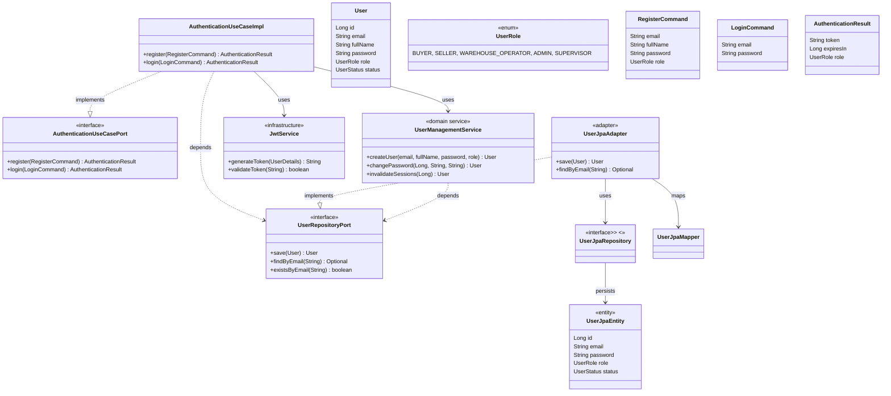
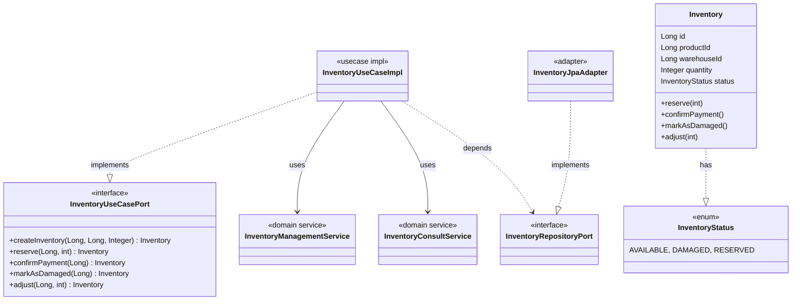
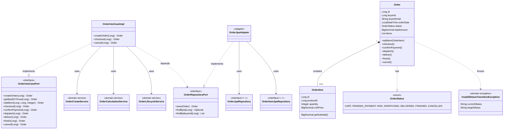
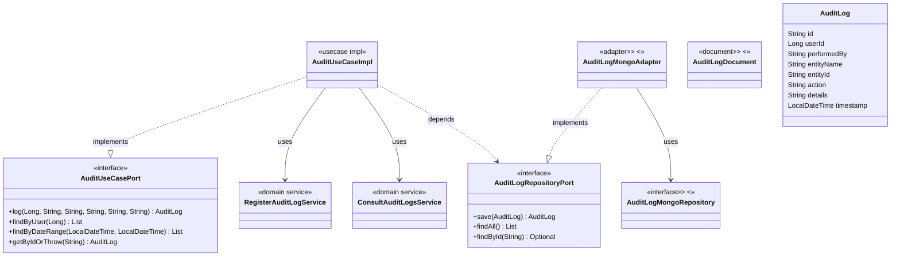

# C4 — Nivel 4: Código

Diagrama de clases (`classDiagram` de Mermaid) por módulo de negocio, mostrando los puertos de entrada (`ports/in`), puertos de salida (`ports/out`), servicios de dominio y modelos reales.

---

## Módulo: Autenticación

---

## Módulo: Usuarios, Compradores y Vendedores

```mermaid
classDiagram
    class UserUseCasePort {
        <<interface>>
        +createUser(email, fullName, password, role) User
        +getUserByIdOrThrow(Long) User
        +findAll() List<User>
        +findByRole(UserRole) List<User>
        +blockUser(Long) User
        +activateUser(Long) User
        +changeRole(Long, UserRole) User
    }
    class UserUseCaseImpl {
        +createUser(...) User
        +getUserByIdOrThrow(Long) User
        +findAll() List<User>
        +blockUser(Long) User
        +activateUser(Long) User
        +changeRole(Long, UserRole) User
    }
    class UserManagementService {
        <<domain service>>
    }
    class UserRepositoryPort {
        <<interface>>
        +save(User) User
        +findById(Long) Optional<User>
        +findAll() List<User>
    }
    class UserJpaAdapter { <<adapter>> }
    class UserJpaRepository { <<interface>> <<JpaRepository>> }
    class User {
        Long id
        String email
        String fullName
        String password
        UserRole role
        UserStatus status
        +block()
        +activate()
        +isActive() boolean
    }
    class BuyerUseCasePort {
        <<interface>>
        +createBuyer(Long, String) Buyer
        +getBuyerByIdOrThrow(Long) Buyer
        +addAdditionalAddress(Long, String) Buyer
        +changeCommercialStatus(Long, BuyerCommercialStatus) Buyer
    }
    class BuyerUseCaseImpl { <<usecase impl>> }
    class CreateBuyerService { <<domain service>> }
    class AddBuyerAddressService { <<domain service>> }
    class ChangeBuyerCommercialStatusService { <<domain service>> }
    class BuyerRepositoryPort { <<interface>> }
    class BuyerJpaAdapter { <<adapter>> }
    class Buyer {
        Long id
        Long userId
        String primaryAddress
        List<String> additionalAddresses
        BuyerCommercialStatus commercialStatus
        +addAdditionalAddress(String)
    }
    class SellerUseCasePort { <<interface>> }
    class SellerUseCaseImpl { <<usecase impl>> }
    class SellerDomainService { <<domain service>> }
    class SellerRepositoryPort { <<interface>> }
    class SellerJpaAdapter { <<adapter>> }
    class Seller {
        Long id
        Long userId
        String taxId
        String companyName
        Boolean active
        +activate()
        +deactivate()
    }
    class UserRole <<enum>> { BUYER, SELLER, WAREHOUSE_OPERATOR, ADMIN, SUPERVISOR }
    class UserStatus <<enum>> { ACTIVE, BLOCKED }
    class BuyerCommercialStatus <<enum>> { ACTIVE, INACTIVE, BLOCKED }

    UserUseCaseImpl ..|> UserUseCasePort : implements
    BuyerUseCaseImpl ..|> BuyerUseCasePort : implements
    SellerUseCaseImpl ..|> SellerUseCasePort : implements
    UserUseCaseImpl --> UserManagementService : uses
    BuyerUseCaseImpl --> CreateBuyerService : uses
    BuyerUseCaseImpl --> AddBuyerAddressService : uses
    BuyerUseCaseImpl --> ChangeBuyerCommercialStatusService : uses
    SellerUseCaseImpl --> SellerDomainService : uses
    UserUseCaseImpl ..> UserRepositoryPort : depends
    BuyerUseCaseImpl ..> BuyerRepositoryPort : depends
    SellerUseCaseImpl ..> SellerRepositoryPort : depends
    UserJpaAdapter ..|> UserRepositoryPort : implements
    BuyerJpaAdapter ..|> BuyerRepositoryPort : implements
    SellerJpaAdapter ..|> SellerRepositoryPort : implements
    User ..|> UserRole : has
    User ..|> UserStatus : has
    Buyer ..|> BuyerCommercialStatus : has
```

---

## Módulo: Catálogo (Productos, Categorías, Bodegas, Catálogo)

```mermaid
classDiagram
    class ProductUseCasePort {
        <<interface>>
        +createProduct(sku, name, description, price, type, sellerId, categoryId) Product
        +getProductByIdOrThrow(Long) Product
        +findByCategory(Long) List<Product>
        +updateProduct(Long, ...) Product
        +deactivateProduct(Long) Product
    }
    class ProductUseCaseImpl { <<usecase impl>> }
    class ProductDomainService { <<domain service>> }
    class ProductRepositoryPort { <<interface>> }
    class ProductJpaAdapter { <<adapter>> }
    class ProductJpaRepository { <<interface>> <<JpaRepository>> }
    class Product {
        Long id
        String sku
        String name
        BigDecimal price
        ProductType type
        Boolean active
        Long sellerId
        Long categoryId
    }
    class ProductType <<enum>> { PHYSICAL, DIGITAL }

    class CategoryUseCasePort { <<interface>> }
    class CategoryUseCaseImpl { <<usecase impl>> }
    class CategoryDomainService { <<domain service>> }
    class CategoryRepositoryPort { <<interface>> }
    class CategoryJpaAdapter { <<adapter>> }
    class Category {
        Long id
        String name
        Long parentId
        List<Category> subCategories
    }

    class WarehouseUseCasePort { <<interface>> }
    class WarehouseUseCaseImpl { <<usecase impl>> }
    class WarehouseDomainService { <<domain service>> }
    class WarehouseRepositoryPort { <<interface>> }
    class WarehouseJpaAdapter { <<adapter>> }
    class Warehouse {
        Long id
        String name
        String location
        WarehouseType type
        Integer capacity
    }
    class WarehouseType <<enum>> { MARKETPLACE, SELLER }

    class CatalogUseCasePort { <<interface>> }
    class CatalogUseCaseImpl { <<usecase impl>> }
    class CatalogOverviewResponseDTO {
        List<Product> products
        List<Category> categories
    }

    ProductUseCaseImpl ..|> ProductUseCasePort : implements
    CategoryUseCaseImpl ..|> CategoryUseCasePort : implements
    WarehouseUseCaseImpl ..|> WarehouseUseCasePort : implements
    CatalogUseCaseImpl ..|> CatalogUseCasePort : implements
    ProductUseCaseImpl --> ProductDomainService : uses
    ProductUseCaseImpl ..> ProductRepositoryPort : depends
    ProductJpaAdapter ..|> ProductRepositoryPort : implements
    Product ..|> ProductType : typed
```

---

## Módulo: Inventario

---

## Módulo: Órdenes (agregado más complejo)

---

## Módulo: Facturación (Facturas y Reembolsos)

```mermaid
classDiagram
    class InvoiceUseCasePort {
        <<interface>>
        +generateInvoice(Long, String) Invoice
        +voidInvoice(Long) Invoice
        +findByOrder(Long) Invoice
    }
    class InvoiceUseCaseImpl { <<usecase impl>> }
    class InvoiceGenerateService { <<domain service>> }
    class InvoiceVoidService { <<domain service>> }
    class InvoiceRepositoryPort { <<interface>> }
    class InvoiceJpaAdapter { <<adapter>> }
    class Invoice {
        Long id
        Long orderId
        String invoiceNumber
        BigDecimal amount
        Boolean active
        Boolean paid
    }

    class RefundUseCasePort {
        <<interface>>
        +createRefund(Long, Long, BigDecimal) Refund
        +approveRefund(Long) Refund
        +rejectRefund(Long) Refund
    }
    class RefundUseCaseImpl { <<usecase impl>> }
    class RefundProcessService { <<domain service>> }
    class RefundApproveService { <<domain service>> }
    class RefundRepositoryPort { <<interface>> }
    class RefundJpaAdapter { <<adapter>> }
    class Refund {
        Long id
        Long invoiceId
        Long returnRequestId
        BigDecimal amount
        RefundStatus status
    }
    class RefundStatus <<enum>> { PENDING, APPROVED, REJECTED, COMPLETED, FAILED }

    InvoiceUseCaseImpl ..|> InvoiceUseCasePort : implements
    RefundUseCaseImpl ..|> RefundUseCasePort : implements
    InvoiceUseCaseImpl --> InvoiceGenerateService : uses
    InvoiceUseCaseImpl --> InvoiceVoidService : uses
    RefundUseCaseImpl --> RefundProcessService : uses
    RefundUseCaseImpl --> RefundApproveService : uses
    InvoiceUseCaseImpl ..> InvoiceRepositoryPort : depends
    RefundUseCaseImpl ..> RefundRepositoryPort : depends
    InvoiceJpaAdapter ..|> InvoiceRepositoryPort : implements
    RefundJpaAdapter ..|> RefundRepositoryPort : implements
    Refund ..|> RefundStatus : has
```

---

## Módulo: Envíos y Devoluciones

```mermaid
classDiagram
    class ShipmentUseCasePort {
        <<interface>>
        +createShipment(Long, Long, String) Shipment
        +updateStatus(Long, ShipmentStatus) Shipment
    }
    class ShipmentUseCaseImpl { <<usecase impl>> }
    class ShipmentCreateService { <<domain service>> }
    class ShipmentStatusService { <<domain service>> }
    class ShipmentRepositoryPort { <<interface>> }
    class ShipmentJpaAdapter { <<adapter>> }
    class Shipment {
        Long id
        Long orderId
        String trackingNumber
        ShipmentStatus status
        LocalDateTime shippedAt
    }
    class ShipmentStatus <<enum>> { PENDING, IN_TRANSIT, DELIVERED, CANCELLED }

    class ReturnUseCasePort {
        <<interface>>
        +createReturn(Long, String) Return
        +approveReturn(Long) Return
        +completeReturn(Long) Return
    }
    class ReturnUseCaseImpl { <<usecase impl>> }
    class ReturnProcessService { <<domain service>> }
    class ReturnRepositoryPort { <<interface>> }
    class ReturnJpaAdapter { <<adapter>> }
    class Return {
        Long id
        Long orderId
        String reason
        ReturnStatus status
        LocalDateTime requestedAt
    }
    class ReturnStatus <<enum>> { REQUESTED, APPROVED, REJECTED, COMPLETED, PROCESSED }

    ShipmentUseCaseImpl ..|> ShipmentUseCasePort : implements
    ReturnUseCaseImpl ..|> ReturnUseCasePort : implements
    ShipmentUseCaseImpl --> ShipmentCreateService : uses
    ShipmentUseCaseImpl --> ShipmentStatusService : uses
    ReturnUseCaseImpl --> ReturnProcessService : uses
    ShipmentUseCaseImpl ..> ShipmentRepositoryPort : depends
    ReturnUseCaseImpl ..> ReturnRepositoryPort : depends
    ShipmentJpaAdapter ..|> ShipmentRepositoryPort : implements
    ReturnJpaAdapter ..|> ReturnRepositoryPort : implements
    Shipment ..|> ShipmentStatus : has
    Return ..|> ReturnStatus : has
```

---

## Módulo: Auditoría

---

## Convenciones de los diagramas de nivel 4

- `<<interface>>`: puerto (`ports/in` o `ports/out`).
- `<<domain service>>`: servicio de negocio puro en `domain/services/`.
- `<<usecase impl>>`: implementación del puerto de entrada en `adapters/useCases/`.
- `<<adapter>>`: implementación del puerto de salida en `adapters/persistence/`.
- `<<entity>>` / `<<document>>`: entidad JPA (MySQL) o documento MongoDB.
- `..|>`: implementación de interfaz.
- `-->`: depende de / usa.
- `*--`: composición (agregado Order contiene OrderItems).
