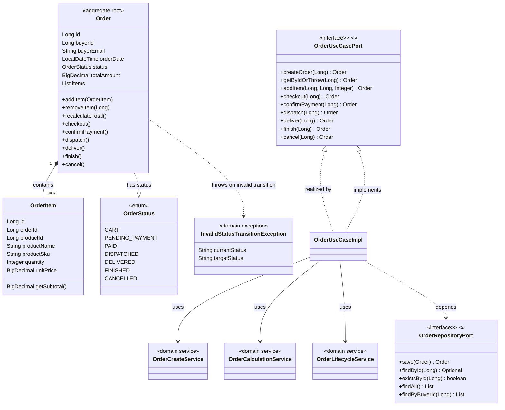

# Modelo de Dominio

Tablas de entidades con campos y relaciones, tomadas del código real en `domain/models/` y `domain/valueobjects/`, seguidas de un `classDiagram` Mermaid del agregado `Order` (el más complejo del sistema).

---

## Entidades de dominio

### User
| Campo | Tipo | Descripción |
|-------|------|-------------|
| id | Long | Identificador |
| email | String | Correo electrónico (único) |
| fullName | String | Nombre completo |
| password | String | Contraseña hasheada con BCrypt |
| role | UserRole | Rol: BUYER, SELLER, WAREHOUSE_OPERATOR, ADMIN, SUPERVISOR |
| status | UserStatus | Estado: ACTIVE, BLOCKED |
| createdAt | LocalDateTime | Fecha de creación |
| updatedAt | LocalDateTime | Fecha de actualización |

Comportamiento: `block()`, `activate()`, `isActive()`.

### Buyer
| Campo | Tipo | Descripción |
|-------|------|-------------|
| id | Long | Identificador |
| userId | Long | FK a User |
| primaryAddress | String | Dirección principal |
| additionalAddresses | List<String> | Direcciones adicionales |
| commercialStatus | BuyerCommercialStatus | ACTIVE, INACTIVE, BLOCKED |

Comportamiento: `addAdditionalAddress(String)`, `removeAdditionalAddress(String)`.

### Seller
| Campo | Tipo | Descripción |
|-------|------|-------------|
| id | Long | Identificador |
| userId | Long | FK a User |
| taxId | String | Identificación tributaria |
| companyName | String | Nombre de la empresa |
| active | Boolean | Activo/inactivo (default true) |

Comportamiento: `activate()`, `deactivate()`.

### Product
| Campo | Tipo | Descripción |
|-------|------|-------------|
| id | Long | Identificador |
| sku | String | SKU único |
| name | String | Nombre del producto |
| description | String | Descripción |
| price | BigDecimal | Precio unitario (> 0) |
| type | ProductType | PHYSICAL, DIGITAL |
| active | Boolean | Activo (default true) |
| sellerId | Long | Vendedor propietario |
| sellerCompanyName | String | Nombre del vendedor (desnormalizado) |
| categoryId | Long | Categoría |
| categoryName | String | Nombre de categoría (desnormalizado) |

### Category
| Campo | Tipo | Descripción |
|-------|------|-------------|
| id | Long | Identificador |
| name | String | Nombre |
| description | String | Descripción |
| parentId | Long | Categoría padre (opcional, jerarquía) |
| parentName | String | Nombre del padre (desnormalizado) |
| subCategories | List<Category> | Subcategorías |

### Warehouse
| Campo | Tipo | Descripción |
|-------|------|-------------|
| id | Long | Identificador |
| name | String | Nombre de la bodega |
| location | String | Ubicación |
| type | WarehouseType | MARKETPLACE, SELLER |
| capacity | Integer | Capacidad |

### Inventory
| Campo | Tipo | Descripción |
|-------|------|-------------|
| id | Long | Identificador |
| productId | Long | Producto |
| productName | String | Nombre del producto (desnormalizado) |
| productSku | String | SKU del producto (desnormalizado) |
| warehouseId | Long | Bodega |
| warehouseName | String | Nombre de la bodega (desnormalizado) |
| quantity | Integer | Cantidad disponible |
| status | InventoryStatus | AVAILABLE, DAMAGED, RESERVED |

Comportamiento: `reserve(int)`, `release(int)`, `markAsDamaged()`, `confirmPayment()`, `adjust(int)`. Invariante: `quantity >= 0`.

### Order (agregado raíz)
| Campo | Tipo | Descripción |
|-------|------|-------------|
| id | Long | Identificador |
| buyerId | Long | Comprador propietario |
| buyerEmail | String | Email del comprador |
| orderDate | LocalDateTime | Fecha de la orden |
| status | OrderStatus | CART, PENDING_PAYMENT, PAID, DISPATCHED, DELIVERED, FINISHED, CANCELLED |
| totalAmount | BigDecimal | Monto total calculado |
| items | List<OrderItem> | Ítems de la orden |

Comportamiento: `addItem(OrderItem)`, `removeItem(Long)`, `recalculateTotal()`, `checkout()`, `confirmPayment()`, `dispatch()`, `deliver()`, `finish()`, `cancel()`. Invariante de transición de estado (véase `reglas-de-negocio.md`).

### OrderItem
| Campo | Tipo | Descripción |
|-------|------|-------------|
| id | Long | Identificador |
| orderId | Long | FK a Order |
| productId | Long | Producto |
| productName | String | Nombre del producto |
| productSku | String | SKU del producto |
| quantity | Integer | Cantidad (>= 1) |
| unitPrice | BigDecimal | Precio unitario |

Comportamiento: `getSubtotal()`.

### Invoice
| Campo | Tipo | Descripción |
|-------|------|-------------|
| id | Long | Identificador |
| orderId | Long | Orden asociada |
| invoiceNumber | String | Número de factura (único) |
| issueDate | LocalDateTime | Fecha de emisión |
| amount | BigDecimal | Monto |
| pdfUrl | String | URL del PDF |
| active | Boolean | Activa (default true) |
| paid | Boolean | Pagada (default true) |

### Refund
| Campo | Tipo | Descripción |
|-------|------|-------------|
| id | Long | Identificador |
| invoiceId | Long | Factura asociada |
| returnRequestId | Long | Devolución asociada (opcional) |
| amount | BigDecimal | Monto del reembolso (> 0) |
| status | RefundStatus | PENDING, APPROVED, REJECTED, COMPLETED, FAILED |

### Return
| Campo | Tipo | Descripción |
|-------|------|-------------|
| id | Long | Identificador |
| orderId | Long | Orden asociada |
| reason | String | Motivo de la devolución |
| status | ReturnStatus | REQUESTED, APPROVED, REJECTED, COMPLETED, PROCESSED |
| requestedAt | LocalDateTime | Fecha de solicitud (default now) |
| resolvedAt | LocalDateTime | Fecha de resolución |

### Shipment
| Campo | Tipo | Descripción |
|-------|------|-------------|
| id | Long | Identificador |
| orderId | Long | Orden asociada |
| warehouseId | Long | Bodega de despacho |
| warehouseName | String | Nombre de la bodega (desnormalizado) |
| trackingNumber | String | Número de tracking |
| status | ShipmentStatus | PENDING, IN_TRANSIT, DELIVERED, CANCELLED |
| shippedAt | LocalDateTime | Fecha de envío |
| deliveredAt | LocalDateTime | Fecha de entrega |

### AuditLog
| Campo | Tipo | Descripción |
|-------|------|-------------|
| id | String | Identificador (UUID) |
| userId | Long | Usuario que ejecutó la acción |
| performedBy | String | Nombre del ejecutor |
| entityName | String | Nombre de la entidad afectada |
| entityId | String | ID de la entidad afectada |
| action | String | Acción realizada |
| details | String | Detalles adicionales |
| timestamp | LocalDateTime | Marca de tiempo |

---

## Value Objects (enums)

| Enum | Valores | Usado en |
|------|---------|----------|
| UserRole | BUYER, SELLER, WAREHOUSE_OPERATOR, ADMIN, SUPERVISOR | User |
| UserStatus | ACTIVE, BLOCKED | User |
| BuyerCommercialStatus | ACTIVE, INACTIVE, BLOCKED | Buyer |
| ProductType | PHYSICAL, DIGITAL | Product |
| OrderStatus | CART, PENDING_PAYMENT, PAID, DISPATCHED, DELIVERED, FINISHED, CANCELLED | Order |
| InventoryStatus | AVAILABLE, DAMAGED, RESERVED | Inventory |
| RefundStatus | PENDING, APPROVED, REJECTED, COMPLETED, FAILED | Refund |
| ReturnStatus | REQUESTED, APPROVED, REJECTED, COMPLETED, PROCESSED | Return |
| ShipmentStatus | PENDING, IN_TRANSIT, DELIVERED, CANCELLED | Shipment |
| WarehouseType | MARKETPLACE, SELLER | Warehouse |

---

## Relaciones

| Relación | Tipo | Cardinalidad | Notas |
|----------|------|--------------|-------|
| User → Buyer | composición (1:1) | Uno a uno | Un usuario puede tener un perfil de comprador |
| User → Seller | composición (1:1) | Uno a uno | Un usuario puede tener un perfil de vendedor |
| Product → Category | asociación (N:1) | Muchos a uno | Un producto pertenece a una categoría |
| Product → Seller | asociación (N:1) | Muchos a uno | Un producto pertenece a un vendedor |
| Inventory → Product | asociación (N:1) | Muchos a uno | Un registro de inventario referencia un producto |
| Inventory → Warehouse | asociación (N:1) | Muchos a uno | Un registro de inventario referencia una bodega |
| Order → Buyer | asociación (N:1) | Muchos a uno | Una orden pertenece a un comprador |
| Order → OrderItem | composición (1:N) | Uno a muchos | Agregado: la orden contiene sus ítems |
| Invoice → Order | asociación (N:1) | Muchos a uno | Una factura referencia una orden |
| Refund → Invoice | asociación (N:1) | Muchos a uno | Un reembolso referencia una factura |
| Refund → Return | asociación (N:1, opcional) | Muchos a uno | Un reembolso puede referenciar una devolución |
| Return → Order | asociación (N:1) | Muchos a uno | Una devolución referencia una orden |
| Shipment → Order | asociación (N:1) | Muchos a uno | Un envío referencia una orden |
| Shipment → Warehouse | asociación (N:1) | Muchos a uno | Un envío referencia una bodega |

---

## ClassDiagram — Agregado Order (el más complejo)

